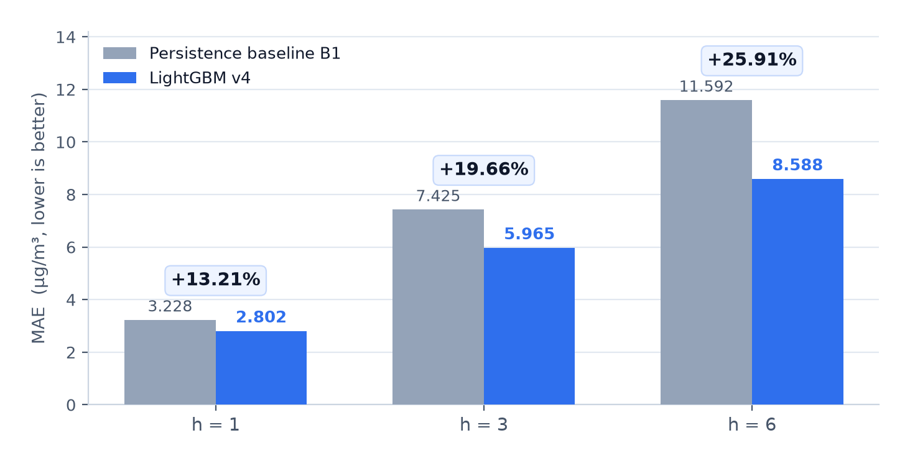
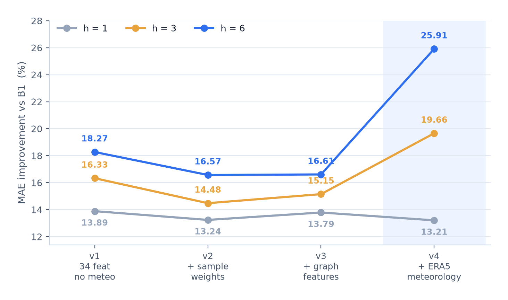
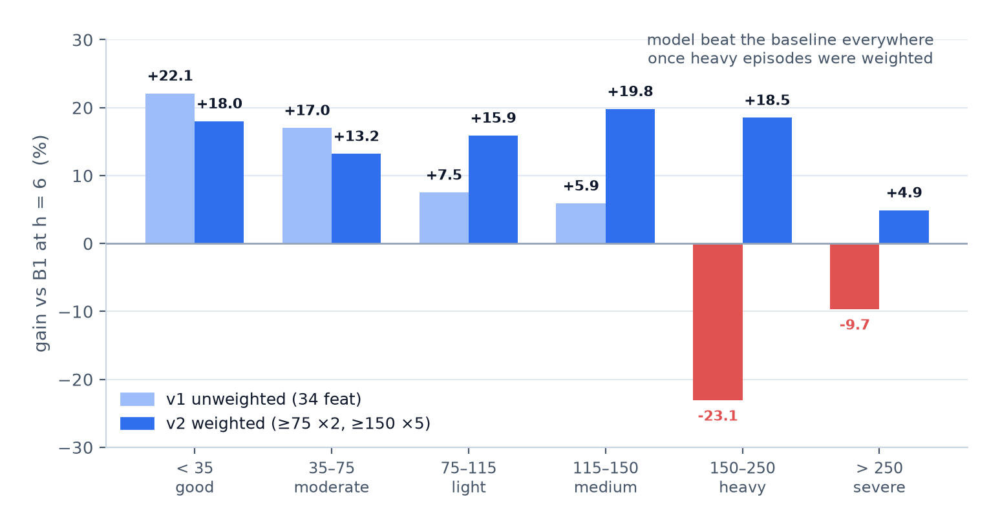
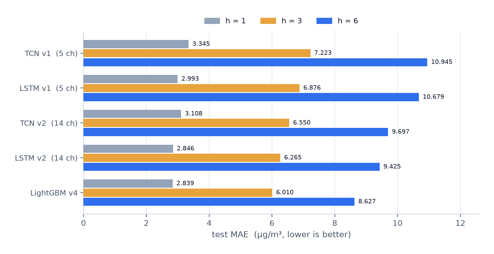

<div align="center">

# bj-air-quality-forecast

**Multi-site PM2.5 short-term forecasting for Beijing — h = 1 / 3 / 6 hours**


Airtight evaluation protocol · 20.4 M rows of real observations · measured against persistence, not against a straw man

[English](README.en.md) · [中文](README.md) · [Results](#6-results) · [Data](#3-data) · [Protocol](#4-evaluation-protocol-p1) · [Reproduce](#9-quickstart)

</div>



> **In one line.** Hourly PM2.5 at 35 Beijing stations, issued at the top of an hour using only
> observations up to `T-1`, predicting one target hour at `h = 1 / 3 / 6`. LightGBM v4 cuts MAE by
> **13.21% / 19.66% / 25.91%** against a persistence baseline on a **pre-frozen, fingerprinted sample
> set** — with daily-block bootstrap confidence intervals that exclude zero by a wide margin.

---

## Table of contents

- [1. What this project is](#1-what-this-project-is)
- [2. Why it is not a toy](#2-why-it-is-not-a-toy)
- [3. Data](#3-data)
  - [3.1 Sources and coverage](#31-sources-and-coverage)
  - [3.2 Warehouse schema](#32-warehouse-schema)
  - [3.3 What the data actually looks like](#33-what-the-data-actually-looks-like)
  - [3.4 Nine traps that were actually hit](#34-nine-traps-that-were-actually-hit)
  - [3.5 Station metadata](#35-station-metadata)
- [4. Evaluation protocol p1](#4-evaluation-protocol-p1)
  - [4.1 Time contract](#41-time-contract)
  - [4.2 Splits](#42-splits)
  - [4.3 The frozen index](#43-the-frozen-index)
  - [4.4 Baselines, and why B2 is useless](#44-baselines-and-why-b2-is-useless)
  - [4.5 Hand-check against raw cells](#45-hand-check-against-raw-cells)
- [5. Model](#5-model)
- [6. Results](#6-results)
  - [6.1 Headline: v4](#61-headline-v4)
  - [6.2 Generation ladder v1 to v4](#62-generation-ladder-v1--v4)
  - [6.3 Peak detection](#63-peak-detection)
  - [6.4 The failure mode: heavy episodes](#64-the-failure-mode-heavy-episodes)
  - [6.5 Feature ablation](#65-feature-ablation)
  - [6.6 Meteorology ablation and the leakage trap](#66-meteorology-ablation-and-the-leakage-trap)
  - [6.7 The weighting trade-off, quantified](#67-the-weighting-trade-off-quantified)
  - [6.8 Seed stability](#68-seed-stability)
  - [6.9 Negative result: the dual-model route](#69-negative-result-the-dual-model-route)
  - [6.10 Deep learning](#610-deep-learning)
  - [6.11 A live forecast, published before verification](#611-a-live-forecast-published-before-verification)
- [7. Demo application](#7-demo-application)
- [8. Repository layout](#8-repository-layout)
- [9. Quickstart](#9-quickstart)
- [10. Limitations](#10-limitations)
- [11. Roadmap](#11-roadmap)
- [12. Documentation](#12-documentation)

---

## 1. What this project is

Air quality management needs to know, at 10:00 sharp, what the next few hours look like — not what
last month looked like. This project builds that: an hourly nowcasting system for 35 monitoring
stations inside Beijing, issuing three independent forecasts per station per hour (1, 3 and 6 hours
ahead), served through a web dashboard and validated on a locked test window.

**Scope**

| | |
|---|---|
| Target | PM2.5 concentration, µg/m³, hourly, at 35 Beijing municipal stations |
| Lead times | h = 1, 3, 6 hours — **three separate single-hour targets**, not a rolling curve |
| Information set | observations up to and including `[T-1, T)`; optional ERA5 meteorology |
| Evaluation | frozen index `p1`, 486 test days, daily-block bootstrap (2000 resamples) |
| Serving | FastAPI + single-page dashboard; leak-free live inference path |
| Stack | pandas / PyArrow warehouse → LightGBM 4.7 → PyTorch 2.11 (LSTM, TCN) → FastAPI |

**Out of scope, stated plainly:** no Kafka, no Spark cluster run (designed, not executed), no PM10 /
O₃ / NO₂ targets, one city only.

---

## 2. Why it is not a toy

**① A frozen protocol, not a sliding evaluation.** `PROTOCOL.md` fixes the issue time, the
information cutoff and the exact target hour, then materialises the sample set once into
`data/index/protocol=p1/` with a SHA-256 fingerprint `20f727bf…`. Every model — LightGBM, LSTM, TCN,
every ablation — reuses the identical 5,266,800 `(station, issue_time, h)` rows. No one can re-filter
the test set to look better.

**② Uncertainty is resampled over days, not rows.** Hourly PM2.5 has lag-1 autocorrelation **0.974**.
Row-level bootstrap would inflate the effective sample size by an order of magnitude and manufacture
false precision, so all intervals resample whole **Beijing calendar days** (486 days at h = 1).

**③ Leakage was hunted, not assumed away.** Open-Meteo's default `best_match` silently falls back to
other models and returned a complete 24-hour "current day" — future hours included. Treating that as
known-at-issue-time would have leaked the future. Pinning `models=era5` fixed it; §6.6 quantifies how
much of the meteorology gain is real and how much depends on perfect forecasts.

**④ Failures are reported as loudly as gains.** The model is **systematically low on heavy pollution**
(§6.4), loses to persistence on the very first live case at h = 1 (§6.11), and the textbook `log1p`
transform made things dramatically worse (§6.4). All of it is written down.

**⑤ Two plausible routes were killed by evidence.** A dual-model peak-warning architecture (§6.9) and
the deep-learning route (§6.10) were both evaluated and then rejected — with the numbers that killed them.

---

## 3. Data

### 3.1 Sources and coverage

  

| Dataset | Source | Coverage | Days | Station-hours | Availability |
|---|---|---|---|---|---|
| `beijing_all` | quotsoft.net daily files | 2013-12-06 → 2026-10-29 | 4,711 | **3,892,140** | **98.35%** |
| `beijing_extra` | quotsoft.net daily files | 2014-04-03 → 2026-10-29 | 4,593 | 3,793,720 | 98.33% |
| `china_cities` | quotsoft.net daily files | 2014-05-13 → 2026-10-29 | 4,553 | 13 Jing-Jin-Ji cities | — |
| `china_sites` | official annual bundles | 2014-05-13 → 2026-10-24 | 4,531 | **11,355,036** (130 stations) | 84.3% observed |
| `meteo` | Open-Meteo `archive-api` (ERA5) | 2013-12 → 2026-10, incremental | — | 22 points × 11 variables | 99.9% |

Things worth knowing about the data itself:

- **Two different networks must not be confused.** `beijing_all` / `beijing_extra` are the 35-station
  municipal network (the prediction target). `china_sites` is the **national** control network, where
  Beijing has only 12 stations — its value is spatial context for Jing-Jin-Ji, not a substitute target.
- **Perfect-score ceiling:** 4,711 days × 24 h × 35 stations = 3,957,240; actual 3,892,140. The gap is
  25 whole days missing at source plus 351 partially missing days — kept and flagged, never imputed.
- **Bundles were verified, not trusted.** Sampling 2024-01-01 / 07-15 / 12-31, the city CSVs inside the
  official archives are **byte-identical** to the scraped daily files.
- **Free-tier arithmetic is a design constraint:** Open-Meteo cost = points × variables × years.
  22 × 11 × 14 = 3,388 stays under the 5,000/hour limit; the earlier 48 × 15 = 10,080 was throttled (429).

### 3.2 Warehouse schema

Layer: `data/warehouse/fact_obs/source=<src>/year=<YYYY>/part.parquet` (zstd), plus
`dim_meteo/point_id=<id>/part.parquet`.

| Column | Type | Meaning |
|---|---|---|
| `date` | str | source file date, `YYYYMMDD` |
| `hour` | int8 | 0–23, **start** of the hour, interval `[hour, hour+1)` |
| `hour_start_local` | datetime | Beijing time = `date + hour` |
| `hour_start_utc` | datetime | UTC = local − 8 h |
| `name_cn` | str | station name, verbatim from the source header |
| `network_era` | str | **A** = 2013-12-06 → 2021-01-17, **B** = 2021-01-24 → |
| `pm25` `pm10` `so2` `no2` `o3` `co` | float | µg/m³ (CO converted from mg/m³, ×1000) |
| `pm25_24h` `pm10_24h` `so2_24h` `no2_24h` `o3_24h` `o3_8h` `o3_8h_24h` `co_24h` | float | rolling statistics supplied by the source — **not** hourly values |
| `aqi` | float | dimensionless index, **not** a concentration |
| `value_status` | str | `observed` / `missing_value` / `out_of_range` (judged on `pm25`) |
| `n_pollutants` | int8 | non-null pollutants in the row |
| `n_out_of_range` | int8 | out-of-physical-range variables |
| `source` | str | dataset name |

Primary key: `(source, network_era, name_cn, hour_start_utc)`.

### 3.3 What the data actually looks like

**Raw daily file** — wide format, one row per `hour × type`, one column per station
(`data/raw/beijing_all/20260615.csv`):

| date | hour | type | 东城东四 | 东城天坛 | 朝阳农展馆 | 海淀万柳 | 定陵(对照点) | 密云镇 |
|---|---|---|---|---|---|---|---|---|
| 20260615 | 10 | PM2.5 | 38 | 42 | 47 | 54 | 44 | 42 |
| 20260615 | 10 | PM10 | 62 | 73 | 80 | 87 | 68 | 65 |

**Warehouse row** — long format, one row per station-hour (real record, `beijing_all`, 2026-06-15 10:00):

| hour | name_cn | pm25 | pm10 | aqi | hour_start_local | hour_start_utc | network_era | value_status | n_pollutants |
|---|---|---|---|---|---|---|---|---|---|
| 10 | 东城东四 | 38.0 | 62.0 | 59.0 | 2026-06-15 10:00 | 2026-06-15 02:00 | B | observed | 3 |

**Frozen index rows** — what every model is scored on (station 东城东四, h = 1):

| issue_time T | h | target window | y_true | B1 = y(T−1) | B2 = y(T−24h) | split |
|---|---|---|---|---|---|---|
| 2026-06-15 09:00 | 1 | 09:00 → 10:00 | 42.0 | 44.0 | 10.0 | test |
| 2026-06-15 10:00 | 1 | 10:00 → 11:00 | 38.0 | 42.0 | 14.0 | test |
| 2026-06-15 11:00 | 1 | 11:00 → 12:00 | `NaN` | 38.0 | 13.0 | test |

The `NaN` is deliberate: the target hour is missing at source, the row stays in the index, and
coverage is reported separately rather than silently dropped or filled.

### 3.4 Nine traps that were actually hit

Every one of these produced silently wrong numbers before being caught. They are documented because
they are the difference between a pipeline that runs and a pipeline that is right.

| # | Trap | Why it is dangerous | Fix |
|---|---|---|---|
| **D1** | **The station network was replaced on 2021-01-24** | Both eras have 35 stations and 38 columns, but only 10 stations correspond; 25 are new. Aligning by column position does not error — it silently mismatches stations | explicit `network_era` column; modelling uses era B only |
| **D2** | `type` mixes `PM2.5`, `PM2.5_24h`, `AQI` in one file | using the 24 h rolling mean as an hourly value inflates scores and makes them unpredictable | exact match on `type == 'PM2.5'` |
| **D3** | CO is in **mg/m³**, everything else µg/m³ | 1000× dimensional error, invisible in plots | normalised to µg/m³ at ingest |
| **D4** | 351 days are *legitimately* partial (e.g. hours 0–17 only) | strict `rows == 120` validation deleted ~340 real days | record `missing_hours`, flag `partial` |
| **D5** | `pivot_table(dropna=True)` drops an all-empty station column | station count silently 35 → 34, no error | forced `dropna=False` |
| **D6** | The set of pollutant types grows over years | treating "type absent" as a defect would flag ~4,200 files | missing type is recorded, only a missing hour counts |
| **D7** | `date` is a column, not a station | `melt` creates a pseudo-station named `date` whose "concentration" is `20200101` | dropped before melt |
| **D8** | Archives contain macOS AppleDouble `._china_sites_*.csv` (4096 bytes, header `\x00\x05\x16\x07`) | same name as the real file after stripping `._` → real data replaced by binary junk, surfaces as `UnicodeDecodeError: byte 0xb0` | filter `._` prefix + magic-byte check |
| **D9** | Archives contain nginx `404 Not Found` HTML (169 bytes) for 2018-12-22 → 12-26 | "exists and non-empty" but is a source outage record | `_is_html_junk()` → register as gap, never parse |

### 3.5 Station metadata

- The official station list (23 versions, 2014-05-13 → 2025-02-25, 1,641 → 2,117 stations) covers
  **national control stations only** — Beijing has just 12 of them.
- The 12 overlapping stations were used to **validate** OpenStreetMap/Nominatim geocoding:
  median deviation **3.75 km**, max **4.22 km**, none above 5 km → geocoding is trustworthy.
- The other 23 municipal stations carry `coord_source=nominatim_osm` with the raw response cached.
- Station codes change over time, so codes are resolved against *the version in force on that date* —
  a 2020 table is never used to explain a 2014 code.

---

## 4. Evaluation protocol p1

### 4.1 Time contract

| Item | Definition |
|---|---|
| Time axis | Beijing time, **hour start**, half-open `[t, t+1)` |
| Issue time `T` | top of an hour |
| Available observations | up to `T-1`, i.e. `[T-1, T)` only |
| Target for lead `h` | the **single hour** `[T+h-1, T+h)` |

For `T = 10:00`:

| Lead | Target window | B1 reads | B2 reads |
|---|---|---|---|
| h = 1 | 10:00 – 11:00 | 09:00 | yesterday 10:00 |
| h = 3 | 12:00 – 13:00 | 09:00 | yesterday 12:00 |
| h = 6 | 15:00 – 16:00 | 09:00 | yesterday 15:00 |

The three leads are **three independent targets**, not samples of one continuous curve.

### 4.2 Splits

| Phase | From | To | Days | Purpose |
|---|---|---|---|---|
| warmup | 2021-01-24 | 2021-02-08 | 15 | feature warm-up, never trained or scored |
| train | 2021-02-08 | 2025-01-01 | 1,423 | fitting |
| val | 2025-01-01 | 2025-07-01 | 181 | model selection, early stopping |
| **test** | 2025-07-01 | 2026-10-30 | **486** | opened once |

Era B only. A station-availability floor of 0.75 keeps all 35 stations (the two weakest are
门头沟三家店 80.2% and 昌平南邵 81.6%).

### 4.3 The frozen index

`data/index/protocol=p1/h={1,3,6}/part.parquet` — **1,755,600 rows per lead**, 35 stations × 50,160
issue times, 5,266,800 rows in total.

| Column | Type | Meaning |
|---|---|---|
| `issue_time` | datetime | `T` |
| `station_name` | category | station (era B naming) |
| `h` | int8 | 1 / 3 / 6 |
| `target_start`, `target_end` | datetime | target window, difference is **always** 1 hour |
| `y_true` | float32 | truth, `NaN` when missing — never filled |
| `b1_persistence` | float32 | `y(T-1)` |
| `b2_yesterday` | float32 | `y(target − 24h)` |
| `split` | category | train / val / test |

Frozen means frozen: all models share these rows, rows with `y_true = NaN` stay in place, and
regenerating the index changes the fingerprint — which would invalidate every number in this README.

### 4.4 Baselines, and why B2 is useless

| h | coverage | B1 MAE (train) | B2 MAE (train) |
|---|---|---|---|
| 1 | 96.77% | **3.74** | 23.32 |
| 3 | 96.77% | **8.35** | 23.31 |
| 6 | 96.77% | **12.89** | 23.31 |

On test: B1 = 3.23 / 7.43 / 11.59, B2 = 20.39 for all three leads.

> `corr(y[t], y[t-1]) = 0.974` but `corr(y[t], y[t-24]) = 0.455`. PM2.5 mean / sd = 32.7 / 35.9 µg/m³.
> "Yesterday at the same hour" is ~6× worse than hourly persistence, so **B2 is not a meaningful
> bar**. Any model whose claim is "beats B2" has proven nothing.

The corollary is the entire justification for this project: persistence at h = 1 already sits at
3.74 µg/m³ against a standard deviation of 35.9 — **a station's own history is nearly exhausted**.
Gains must come from meteorology (wind, boundary-layer height) and from neighbouring stations.

### 4.5 Hand-check against raw cells

`scripts/verify_index.py` bypasses the index builder and recomputes from raw CSV cells:

```
station 东城东四   T = 2026-06-15 10:00
 h  target window     manual y_true  index y_true   manual B1  index B1   manual B2  index B2
 1  06-15 10:00—11:00        38           38            42        42          14        14   OK
 3  06-15 12:00—13:00        39           39            42        42          12        12   OK
 6  06-15 15:00—16:00        54           54            42        42          16        16   OK
```

All 3 stations × 3 leads match, covering day boundaries (22:00 issue → 03:00 target) and month
boundaries. In addition the builder asserts on **all** 5,266,800 rows that
`target_start − issue_time == h − 1 hours` and `target_end − target_start == 1 hour`.

---

## 5. Model

| Item | Value |
|---|---|
| Model | LightGBM `objective=regression_l1` (optimises MAE directly) |
| Features (v3) | 39 — station lags 8, rolling/diff 9, same-station other pollutants 6, Beijing background 1, regional means 3, graph features 5, time encoding 7 |
| Features (v4) | 52 — the above + ERA5 variables (meteorology at `T-1` and at the target hour) |
| Sample weights | PM2.5 ≥ 75 → ×2, ≥ 150 → ×5 (v3); ×3 / ×10 for v4 |
| Early stopping | val MAE, 100 rounds |
| Neighbourhood features | `nb_*` distance-weighted, `nbinv_*`, `bj_bg_loo` (leave-one-out), `region_city_mean` — leave-one-out so a station's own value never leaks into its own "regional background" |
| Time encoding | built from the **target hour's** clock, not the issue time — a 10:00 issue at h = 6 targets 15:00, and pollution has a diurnal cycle |
| Deep learning | LSTM / TCN, SEQ = 24, 5-channel (v1) and 14-channel (v2) inputs, PyTorch 2.11 + cu128 on an A40 |

---

## 6. Results

### 6.1 Headline: v4

LightGBM v4 — 52 features, ERA5 meteorology, weights ×3 / ×10. Test window 2025-07-01 → 2026-10-30.

| h | MAE | B1 MAE | improvement | 95% CI | P(gain ≤ 0) | significant |
|---|---|---|---|---|---|---|
| 1 | 2.802 | 3.228 | **+13.21%** | +11.11% – +15.00% | 0.0000 | yes |
| 3 | **5.965** | 7.425 | **+19.66%** | +18.27% – +21.00% | 0.0000 | yes |
| 6 | **8.588** | 11.592 | **+25.91%** | +24.04% – +27.84% | 0.0000 | yes |

Bootstrap: 2,000 resamples over Beijing calendar days (486 days at h = 1, 484 at h = 6).

### 6.2 Generation ladder v1 → v4



*Each step adds exactly one thing; the long leads are where meteorology pays off.*

| Version | Change | h = 1 | h = 3 | h = 6 |
|---|---|---|---|---|
| v1 | 34 features, no meteorology | +13.89% | +16.33% | +18.27% |
| v2 | + sample weights (×2 / ×5) | +13.24% | +14.48% | +16.57% |
| v3 | + graph features (39 total) | +13.79% | +15.15% | +16.61% |
| **v4** | + ERA5 (52 total), weights ×3 / ×10 | +13.21% | **+19.66%** | **+25.91%** |

Absolute MAE along the ladder: v1 2.780 / 6.213 / 9.474 → v2 2.800 / 6.350 / 9.671 →
v3 2.783 / 6.300 / 9.666 → v4 2.802 / 5.965 / 8.588.

Note that v2 and v3 *lower* the headline gain on purpose: weighting trades average accuracy for
accuracy where people actually care (§6.7).

### 6.3 Peak detection

Threshold = each station's q95 on the training period.

| h | Model | Precision | Recall | F1 | events |
|---|---|---|---|---|---|
| 1 | LightGBM v1 | 0.918 | 0.879 | **0.898** | 9,401 |
| 1 | B1 | 0.884 | 0.886 | 0.885 | 9,236 |
| 3 | LightGBM v1 | 0.818 | 0.717 | **0.764** | 9,401 |
| 3 | B1 | 0.725 | 0.731 | 0.728 | 9,148 |
| 6 | LightGBM v1 | **0.724** | 0.552 | **0.626** | 9,401 |
| 6 | B1 | 0.578 | **0.588** | 0.583 | 9,108 |

The model buys precision with recall at h = 6: when it calls a peak it is right far more often than
persistence, but it misses some. After weighting (v2) the h = 6 recall rises to 0.651 — the first time
it clearly beats B1 (0.588) — and F1 rises to 0.638.

### 6.4 The failure mode: heavy episodes



*Gain versus B1 at h = 6, split by true concentration. Left bars: unweighted. Right bars: weighted. Same data, same split.*

Unweighted, the gain **decreases monotonically with concentration and turns negative**:

| concentration band | n (h=1) | h = 1 | h = 3 | h = 6 |
|---|---|---|---|---|
| good (< 35) | 295,324 | +14.6% | +19.5% | **+22.1%** |
| moderate (35–75) | 75,278 | +14.0% | +14.4% | +17.0% |
| light (75–115) | 18,728 | +12.2% | +7.7% | +7.5% |
| medium (115–150) | 4,807 | +9.4% | +7.2% | +5.9% |
| **heavy (150–250)** | 2,249 | +4.5% | **−0.9%** | **−23.1%** |
| **severe (> 250)** | 9 | **−26.5%** | **−41.6%** | **−9.7%** |

Classic regression to the mean: extreme samples are rare, and an L1 objective makes trees
conservative, so peaks get flattened. At h = 6 the heavy band is 32.0 µg/m³ MAE versus 26.0 for
persistence — the whole failure is concentrated there. (The severe band holds 9 samples; the
direction is consistent but the magnitude is not statistically meaningful, and is labelled as such.)

**Three fixes were tried, five variants:**

| h | variant | overall MAE | overall gain | heavy-band MAE | heavy-band B1 | heavy gain | peak F1 |
|---|---|---|---|---|---|---|---|
| 1 | base | 2.780 | +13.89% | 6.91 | 6.89 | −0.2% | 0.898 |
| 1 | **weights** | 2.800 | +13.24% | 6.22 | 6.89 | **+9.8%** | 0.898 |
| 3 | base | 6.213 | +16.33% | 17.40 | 16.47 | −5.6% | 0.764 |
| 3 | **weights** | 6.350 | +14.48% | 15.03 | 16.47 | **+8.8%** | 0.761 |
| 6 | base | 9.474 | +18.27% | 33.69 | 26.57 | −26.8% | 0.626 |
| 6 | weights | 9.671 | +16.57% | 22.51 | 26.57 | **+15.3%** | 0.638 |
| 6 | q60 quantile | 9.725 | +16.10% | 26.40 | 26.57 | +0.6% | 0.637 |
| 6 | q75 quantile | 11.203 | +3.35% | 20.95 | 26.57 | +21.1% | 0.634 |
| 6 | `log1p` | 9.879 | +14.77% | 50.78 | 26.57 | **−91.2%** | 0.485 |

> **Sample weighting is the only fix that works at all three leads**, flipping −0.2 / −5.6 / −26.8%
> into **+9.8 / +8.8 / +15.3%** for 0.5–2.3 points of average accuracy. Worth it.
>
> **`log1p` failed spectacularly and in the wrong direction** — heavy-band MAE 33.69 → 50.78,
> peak F1 down to 0.485. The textbook remedy for right-skewed data is wrong here: compressing the
> extremes harder, then mapping an L1 centre back, still undershoots. Filed as *"conventional wisdom
> does not automatically transfer"*.
>
> **Quantile loss is a sledgehammer** — α = 0.75 reaches +21.1% on heavy episodes and recall 0.742,
> but overall gain collapses to +3.35%. Usable only as a dedicated warning model, if at all (§6.9).

After weighting, the gradient disappears (v2, h = 6): +18.0 / +13.2 / +15.9 / +19.8 / **+18.5** / +4.9 —
a stable +7% to +20% band, at the cost of the cleanest band dropping from +22.1% to +18.0%.

### 6.5 Feature ablation

39-feature weighted configuration, seed 42, test split. Gain versus B1:

| feature group removed | # | h = 1 | h = 3 | h = 6 |
|---|---|---|---|---|
| **full** | 39 | **+13.83%** | **+15.48%** | +16.25% |
| graph features (`nb_*`) | 34 | +13.13% | +14.84% | **+16.36%** |
| neighbourhood (Beijing background + regional means) | 35 | +13.50% | +14.03% | +13.55% |
| same-station other pollutants | 33 | +13.09% | +14.10% | +15.02% |
| rolling statistics | 30 | +12.91% | +14.43% | +15.82% |
| **time encoding** | 32 | **+12.57%** | **+12.59%** | **+12.80%** |
| **lags only** | 8 | **+8.66%** | **+4.85%** | **+3.18%** |

Heavy-band (≥ 150 µg/m³) gain:

| group | h = 1 | h = 3 | h = 6 |
|---|---|---|---|
| full | **+11.1%** | **+13.1%** | **+20.0%** |
| graph features | +9.1% | +9.4% | +15.2% |
| neighbourhood | +11.1% | +11.2% | +20.1% |
| same-station pollutants | +8.5% | +12.1% | +12.4% |
| rolling statistics | +8.1% | +12.0% | +19.8% |
| time encoding | +9.0% | +10.9% | +7.3% |
| lags only | +4.3% | +8.4% | **−6.0%** |

Peak F1: full **0.900 / 0.767 / 0.651**; lags-only 0.891 / 0.734 / 0.568.

Four conclusions:

1. **Time encoding is the single most valuable group** — removing it costs 1.26 / 2.89 / 3.45 points
   overall and 12.8 points on heavy episodes at h = 6. Lags carry "the last hour", not "what time it
   is or what season".
2. **Station lags alone are not enough, and get weaker with lead time**: +8.66% at h = 1 is mostly
   persistence; by h = 6 only +3.18%, and negative on heavy episodes. The third independent
   confirmation that a station's own history is nearly exhausted (§4.4).
3. **Graph features move accuracy toward high concentrations** — heavy band **+2.0 / +3.7 / +4.8**
   points and peak F1 +0.002 / +0.005 / +0.010 — while being roughly neutral on the average
   (−0.70 / +0.64 / −0.11). Redistribution, not a free lunch. The longer the lead, the bigger the payoff.
4. **Rolling statistics matter more than an earlier draft claimed.** Removing them costs
   0.92 / 1.05 / 0.43 points — larger at short leads, unlike graph features.

### 6.6 Meteorology ablation and the leakage trap

**The trap first.** Open-Meteo's default `best_match` silently falls back to other models when ERA5 is
unavailable and returned a complete 24-hour "current day" — including hours that had not happened.
Pinned `models=era5`. Known limits, verified: ERA5 ends around early October 2026 (the last ~3 weeks are
`NaN`, not interpolated); `boundary_layer_height` is missing for **2024-01 → 2024-06** (upstream hole);
other variables 99.9% available.

Physical-direction check passes at h = 6: BLH −0.176, wind speed −0.135, VPD −0.181, temperature
−0.186, humidity +0.146, pressure +0.073 — all plausible in sign and magnitude (a 0.8+ correlation
would have suggested leakage, not skill).

**Ablation (gain vs B1):**

| feature set | # | h = 1 | h = 3 | h = 6 |
|---|---|---|---|---|
| full (meteo at `T-1` **and** target hour) | 52 | **+15.56%** | **+21.94%** | **+27.63%** |
| target-hour meteo only | 49 | +15.36% | +21.76% | +27.33% |
| **`T-1` meteo only (strictly known at issue)** | 42 | +14.34% | **+16.48%** | **+18.13%** |
| no meteorology | 39 | +13.83% | +15.48% | +16.25% |

Peak F1: full 0.902 / **0.784** / **0.695**; `T-1`-only 0.902 / 0.772 / 0.652; no-meteo 0.900 / 0.767 / 0.651.

> **Most of the meteorology value comes from weather at the target hour, not at issue time.**
> `T-1` weather is worth **0.5 / 1.0 / 1.9** points; target-hour weather is worth **1.2 / 5.5 / 9.5** points.
>
> ERA5 is reanalysis — a perfect forecast. So **+27.63% is an upper bound and +18.13% is the
> deliverable floor.** Both must be reported together, with the reason for the gap: the value of
> meteorology depends on forecast quality, not on observation quality.

An anomaly was also investigated and resolved: an earlier one-lead analysis claimed meteorology *hurt*
heavy episodes. A weight × meteorology cross experiment showed it was **hyper-parameter mismatch** —
the ≥150 ×5 weights were tuned for the no-meteo model. With meteorology added, the model leans less on
`pm25_lag1`, so heavier weights are needed to pull attention back to extremes. At h = 6, meteorology
with ×3 / ×10 reaches heavy +21.3% and ×5 / ×20 reaches +27.5%, both above the no-meteo best (+25.4%).

> Lesson recorded in the docs: an ablation must re-tune its hyper-parameters, or "feature removed" and
> "best hyper-parameters changed" get confounded, and a mis-tuned weight gets misread as a harmful feature.

### 6.7 The weighting trade-off, quantified

v4 (meteo + ×3 / ×10) versus ×2 / ×5, per lead:

| h | ×3×10 overall | ×3×10 heavy | ×2×5 overall | ×2×5 heavy | overall Δ | heavy Δ | **exchange rate** |
|---|---|---|---|---|---|---|---|
| 1 | +13.21% | +12.3% | **+15.56%** | +9.9% | −2.35 | **+2.4** | **1 : 1.0** |
| 3 | +19.66% | +15.9% | **+21.94%** | +8.8% | −2.28 | **+7.1** | **1 : 3.1** |
| 6 | +25.91% | +21.3% | **+27.63%** | +12.8% | −1.72 | **+8.5** | **1 : 4.9** |

Peak F1 is essentially identical across both weightings (0.901/0.902, 0.784/0.784, 0.693/0.695), so
**F1 cannot be used to choose weights**. The honest phrasing is not "h = 1 prefers light weights" but
"the accuracy you pay for heavy-episode accuracy converts at 1 : 1, 1 : 3.1 and 1 : 4.9" — hence
×2 / ×5 at h = 1 and ×3 / ×10 at h = 3 and h = 6.

### 6.8 Seed stability

| seed | h = 1 | h = 3 | h = 6 |
|---|---|---|---|
| 7 | +13.43% | +15.35% | +16.42% |
| 42 | +13.83% | +15.48% | +16.25% |
| 2024 | +13.74% | +15.18% | +16.53% |
| **mean** | **13.67%** | **15.34%** | **16.40%** |
| sd | 0.21 | 0.15 | 0.14 |
| range | 0.40 | 0.30 | 0.28 |

Heavy-band gain: mean 10.4% / 13.1% / 20.7%, sd 0.9 / 0.5 / 1.2.

> The three seeds span only 0.28–0.40 points — *narrower* than the bootstrap CI of ±0.7–1.5 points.
> Two things follow: the result is not seed luck, and **the real uncertainty comes from which days
> you happen to test on, not from random initialisation** — which is exactly why the bootstrap is
> day-block, not row-level.

### 6.9 Negative result: the dual-model route

§6.4 suggested a "main model + dedicated peak-warning q75 model" architecture. It was tested and
**rejected**:

| h | variant | overall gain | heavy gain | P | R | F1 |
|---|---|---|---|---|---|---|
| 1 | base | +14.54% | +2.2% | 0.914 | 0.883 | 0.899 |
| 1 | **weighted** | +13.79% | +10.3% | 0.910 | 0.892 | **0.901** |
| 1 | q75 | −2.07% | +1.1% | 0.845 | **0.939** | 0.890 |
| 3 | base | +16.90% | −6.1% | 0.814 | 0.722 | 0.765 |
| 3 | **weighted** | +15.15% | +12.3% | 0.762 | 0.774 | **0.768** |
| 3 | q75 | −0.81% | +11.9% | 0.675 | **0.853** | 0.754 |
| 6 | base | +18.27% | −26.8% | 0.724 | 0.552 | 0.626 |
| 6 | **weighted** | +16.57% | +15.3% | 0.626 | 0.651 | **0.638** |
| 6 | q75 | +3.35% | +21.1% | 0.554 | **0.742** | 0.634 |

q75 never beats the weighted single model on F1; it only swaps precision for recall. And a single
model can do that by **moving the threshold**:

| strategy (h = 6) | P | R | F1 |
|---|---|---|---|
| v3 default threshold (×1.00) | 0.627 | 0.687 | **0.656** |
| v3 threshold ×0.95 | 0.573 | 0.745 | 0.648 |
| v3 threshold ×0.90 | 0.512 | 0.798 | 0.624 |
| q75 standalone model | 0.554 | 0.742 | 0.634 |

At matched recall (~0.74), the single model at ×0.95 dominates the purpose-built quantile model.
**A second model is a redundant layer of complexity.** The right way to do warning is one model plus
a published P-R curve and a business-selected operating point.

### 6.10 Deep learning



*Measured in one GPU run on the A40 host; the LightGBM baseline here is that run's re-fit (2.839 / 6.010 / 8.627). The formal v4 run reports 2.802 / 5.965 / 8.588 — ordinary run-to-run variation.*

| Model | h = 1 MAE | h = 3 MAE | h = 6 MAE | gain vs B1 (1/3/6) |
|---|---|---|---|---|
| LightGBM v4 (baseline) | 2.839 | 6.010 | 8.627 | +12.1% / +19.1% / +25.6% |
| LSTM v1 (5 ch) | 2.993 | 6.876 | 10.679 | +6.8% / +7.1% / +7.7% |
| TCN v1 (5 ch) | 3.345 | 7.223 | 10.945 | −4.2% / +2.4% / +5.4% |
| **LSTM v2 (14 ch)** | **2.846** | **6.265** | **9.425** | **+10.8% / +15.0% / +18.2%** |
| TCN v2 (14 ch) | 3.108 | 6.550 | 9.697 | +2.6% / +11.1% / +15.8% |

The 14-channel input: PM2.5, PM10, AQI, `region_city_mean`, six meteorological channels, and hour /
day-of-week sine-cosine. Sequence length 24, normalisation fitted on train only, any window with a
missing channel dropped (no leakage). 15 epochs, up to 800k training samples, one A40.

1. **v2 roughly doubles v1's advantage**: LSTM goes from +6.8 / +7.1 / +7.7% to **+10.8 / +15.0 / +18.2%**.
2. **LSTM v2 catches LightGBM at h = 1** (2.846 vs 2.839, a 0.007 difference) and narrows h = 3/6 from
   ~12% / ~19% to ~4% / ~9%. The "deep learning lags" story was really a *feature information* story.
3. **TCN loses to LSTM**, especially at h = 1 — mean pooling plus shallow convolution underuses the
   very strong one-hour autocorrelation.
4. It is still not selected: tied at h = 1, worse at h = 3/6, far more expensive to run.

**Jing-Jin-Ji neighbourhood ablation** (LightGBM, 500k training samples, 400 trees):

| h | with neighbourhood | without | MAE reduction |
|---|---|---|---|
| 1 | 2.800 | 2.868 | **2.37%** |
| 3 | 5.925 | 6.294 | **5.86%** |
| 6 | 8.366 | 9.003 | **7.08%** |

The longer the lead, the more spatial context is worth.

### 6.11 A live forecast, published before verification

Not a backtest: the predictions were issued at **2026-10-31 23:00**, before the target hours existed,
then reconciled against what actually happened.

| h | target hour | matched | MAE | B1 MAE | win rate | RMSE |
|---|---|---|---|---|---|---|
| 1 | 10-31 23:00 | 35 | 1.91 | **1.71** | 31.4% | 2.42 |
| 3 | 11-01 01:00 | 35 | **3.41** | 4.31 | 80.0% | 3.93 |
| 6 | 11-01 04:00 | 35 | **4.34** | 4.37 | 57.1% | 5.13 |

Overall 105 rows: MAE 3.22, mean bias **−2.59** (systematic under-prediction), worst single
under-prediction −13.4 µg/m³.

Three things that must be said out loud:

1. **h = 1 lost to persistence** (1.91 vs 1.71, 31.4% win rate). Not a pipeline bug: over 400k samples
   persistence at h = 1 averages 3.23 against the model's 2.78, but **for 35 stations at one instant,
   one-hour persistence is brutally strong**.
2. **Systematic −2.59 bias**, with the five worst errors all under-predictions — the same
   regression-to-the-mean defect seen in §6.4, now visible in production. This is why sample weighting exists.
3. **105 rows prove nothing.** One instant × 35 stations × 3 leads is statistically one sample. Its value
   is that the end-to-end path produces checkable output — not that the model is good.

Sample of the reconciliation file (`data/predictions/verify_20261031_2300.csv`), h = 3:

| station | target | predicted | actual | B1 |
|---|---|---|---|---|
| 东城东四 | 2026-11-01 01:00 | 11.8 | 15.0 | 10.0 |
| 丰台云岗 | 2026-11-01 01:00 | 14.5 | 18.0 | 14.0 |
| 亦庄开发区 | 2026-11-01 01:00 | 10.6 | 16.0 | 9.0 |
| 京东南区域点 | 2026-11-01 01:00 | 14.9 | 11.0 | 14.0 |

---

## 7. Demo application

FastAPI service hosting a single-page dashboard (Vue 3 via CDN, no build step).

```bash
python -m uvicorn app.main:app --host 0.0.0.0 --port 8000
```

| Endpoint | Returns |
|---|---|
| `GET /api/stations` | 35 modelled stations with coordinates |
| `GET /api/overview` | coverage, missing rate, timeline completeness |
| `GET /api/trend?station=&start=&end=` | multi-pollutant time series for one station |
| `GET /api/replay?station=&h=&mode=` | prediction replay with a two-mode guard |
| `GET /api/comparison` | v4 metrics, peak detection, feature importance, DL results |

Dashboard tabs: **overview · station trend · forecast replay · model comparison · live forecast**.

---

## 8. Repository layout

```
src/aircast/            protocol and metric definitions (importable package)
scripts/                ingest → warehouse → index → features → train → evaluate → live predict
  fetch_quotsoft.py     daily-file scraper with resume
  fetch_meteo.py        ERA5 via Open-Meteo, quota-aware batching
  extract_zips.py       official annual bundles (with ._ and 404-HTML filtering)
  build_long.py         wide → long warehouse, source-trap handling
  build_stations.py     station metadata + OSM geocoding (+ cache)
  build_index.py        freeze protocol p1: rows, B1, B2, fingerprint
  build_features.py     feature tables per lead time
  build_meteo_features.py / build_nb_features.py
  train_lgbm.py         --seed --tag --weight --w-mid --w-heavy
  train_dl.py / train_dl2.py   LSTM / TCN, 5-channel and 14-channel
  evaluate.py           --run --split  (daily-block bootstrap, peak P/R/F1, bands)
  experiment_ablation.py / experiment_weight.py / experiment_heavy.py
  predict_live.py       live inference, self-checks against the frozen features
  verify_index.py       recompute from raw cells, bypassing the builder
  qc_report.py          quality metrics and gap ledger
app/                    FastAPI service + static dashboard
docs/figures/           README figures + the script that generates them
data/experiments/       per-experiment metric CSVs (ablation, seeds, meteo, heavy)
data/reports/           QC summary and gap ledgers
data/predictions/       live forecast reconciliation
核验依据/                data-sample verification records
PROTOCOL.md             time contract, baselines, splits, fingerprint
RESULTS.md              every experiment, including negative results
DATA.md                 data dictionary, coverage, quality defects
M5_深度学习结果.md        LSTM / TCN results and the neighbourhood ablation
北京空气质量短期预测项目指导书.md / .pdf / .docx   full project specification
```

**Deliberately not committed** (see `.gitignore`): `data/raw` (9.4 GB), `data/warehouse` (232 MB),
`data/features` (278 MB), `data/meta` (16 MB), `data/index` (19 MB), `data/manifests` (6.5 MB), the
downloaded archives (3.2 GB), the training bundle, ~40 training logs, all `*.parquet` / `*.pt`, and one
cluster-access helper script that contains an internal IP and a personal username.

---

## 9. Quickstart

```bash
python -m venv .venv
source .venv/Scripts/activate      # Windows;  use .venv/bin/activate on Linux/macOS
pip install -r requirements.lock.txt
export PYTHONPATH=src
```

### Rebuild the data layer (needs network; ~10 GB download)

```bash
python scripts/fetch_quotsoft.py --dataset beijing_all   --start 20131206 --end 20261029 --workers 8
python scripts/fetch_quotsoft.py --dataset beijing_extra --start 20140403 --end 20261029 --workers 8
python scripts/fetch_quotsoft.py --dataset china_cities  --start 20140513 --end 20261029 --workers 6
python scripts/fetch_meteo.py    --start 20131201 --end 20261029 --workers 1
python scripts/extract_zips.py   --kind china_sites        # needs the official bundles locally
```

### Build the warehouse, freeze the index, train, evaluate

```bash
python scripts/build_long.py --source beijing_all
python scripts/build_long.py --source beijing_extra
python scripts/build_long.py --source china_cities
python scripts/build_sites.py
python scripts/build_stations.py
python scripts/build_meteo.py
python scripts/qc_report.py

python scripts/build_index.py                 # freeze protocol p1 + fingerprint
python scripts/verify_index.py                # hand-check against raw cells
python scripts/build_features.py
python scripts/build_meteo_features.py
python scripts/build_nb_features.py

python scripts/train_lgbm.py --seed 42 --tag v4 --weight --w-mid 3 --w-heavy 10
python scripts/evaluate.py --run data/runs/<run_id> --split test
```

### Live inference and serving

```bash
python scripts/predict_live.py --time "2026-10-31 23:00"
python -m uvicorn app.main:app --host 0.0.0.0 --port 8000
```

`predict_live.py` deliberately does **not** touch the frozen index — rebuilding it just to predict a new
hour would change the fingerprint and invalidate every existing experiment. Instead it recomputes
features from the warehouse and **asserts cell-by-cell agreement with the frozen feature table** on
overlapping timestamps, aborting if the two paths have diverged.

### Regenerate the figures

```bash
python -m pip install --target .tmp_pylibs matplotlib
PYTHONPATH=.tmp_pylibs python docs/figures/make_figures.py
```

---

## 10. Limitations

- **Reanalysis, not forecast.** The headline +25.91% at h = 6 assumes near-perfect target-hour weather.
  The honestly deliverable number is **+18.13%** (only information available at issue time). Swapping
  ERA5 for Open-Meteo's historical *forecast* archive is the next step, and it will lower the headline.
- **Heavy pollution remains the weak spot.** Weighting fixes the systematic under-prediction but does not
  make the model equal to persistence on extreme episodes at long leads.
- **Spark / Hadoop is designed, not executed.** The pipeline is single-node pandas + LightGBM. The
  distributed version is future work and is not claimed as done.
- **Some coordinates are approximate** — 23 municipal stations rely on OSM geocoding, validated only
  against the 12 official ones.
- **One city, one pollutant family.** Do not extrapolate to another region without re-validating the
  neighbourhood features.
- **The A40 experiments are not reproducible on a laptop** — LSTM/TCN training needs the GPU host; only
  their metrics and configs are recorded here.
- **No license yet** (course project). Ask before reuse.

---

## 11. Roadmap

| Status | Item |
|---|---|
| done | sample weighting for heavy episodes |
| done | three-lead feature ablation |
| done | graph features + v3 baseline + seed stability |
| rejected | dual-model peak warning (single model + threshold dominates) |
| done | ERA5 meteorology, leakage trap fixed, weight × meteorology cross experiment |
| done | LSTM / TCN evaluation |
| next | historical **forecast** fields instead of reanalysis — turn the upper bound into a deliverable |
| next | upwind-weighted `nb_*` features using ERA5 wind direction (currently undirected distance) |
| next | v4 re-run against a fresh live forecast to see whether h = 1 can be won |
| next | Spark ML migration once cluster access is settled |
| optional | Kafka + Structured Streaming for true streaming inference |

---

## 12. Documentation

The Chinese edition is the default front page: [`README.md`](README.md). Source documents are also
Chinese-first and are kept in sync with both READMEs:

| Document | Contents |
|---|---|
| [`PROTOCOL.md`](PROTOCOL.md) | time contract, baselines, splits, index schema, hand-check |
| [`RESULTS.md`](RESULTS.md) | every experiment and its numbers, including failures and open questions |
| [`DATA.md`](DATA.md) | data dictionary, coverage, quality report, the nine traps |
| [`M5_深度学习结果.md`](M5_深度学习结果.md) | LSTM / TCN setup, results, neighbourhood ablation |
| [`北京空气质量短期预测项目指导书.md`](北京空气质量短期预测项目指导书.md) | full project specification (PDF / Word alongside) |
| [`阅读说明.md`](阅读说明.md) | how the three collaborators use these documents |

<div align="center">

---

Built with real data, a frozen protocol, and an unusual willingness to publish the numbers that lost.

</div>
