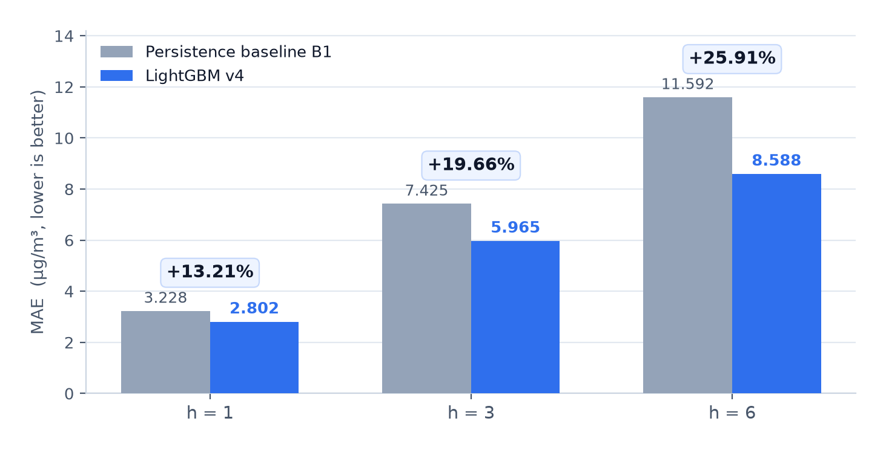
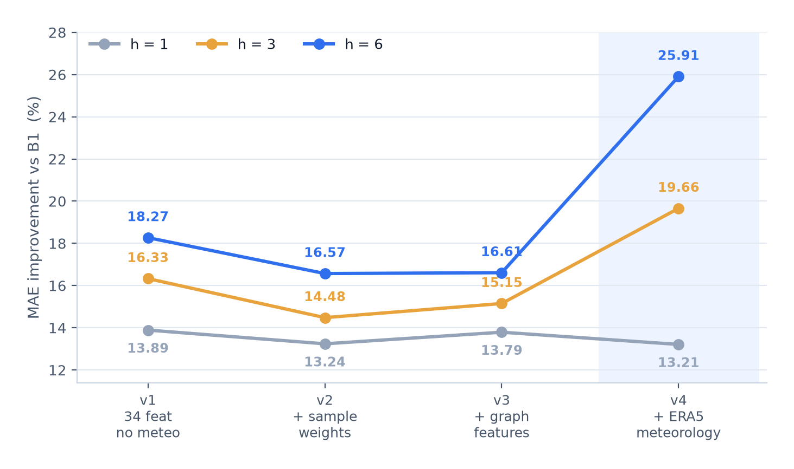
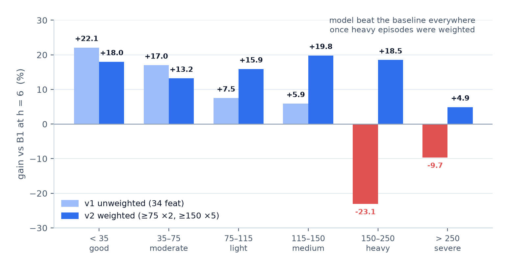
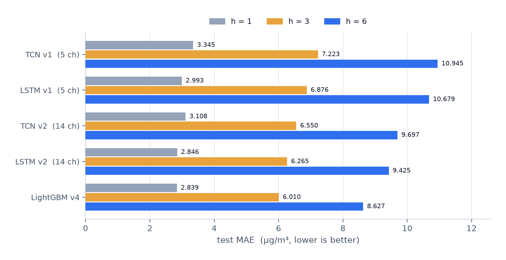

<div align="center">

# bj-air-quality-forecast

**北京多站点 PM2.5 短时预测 — h = 1 / 3 / 6 小时**


冻结的评价协议 · 2042 万行真实观测 · 对手是持久性基线，不是稻草人

[English](README.md) · [中文](README.zh-CN.md) · [实验结果](#6-实验结果) · [数据](#3-数据) · [协议](#4-评价协议-p1) · [复现](#9-快速开始)

</div>



> **一句话。** 35 个北京站点的逐小时 PM2.5，在整点发布、只用 `T-1` 及更早的观测，预测第 h 小时这一个目标小时。
> LightGBM v4 在**预先冻结、带指纹的固定样本集**上，相对持久性基线把 MAE 降低
> **13.21% / 19.66% / 25.91%**，按自然日整块 bootstrap 的置信区间远离零。

---

## 目录

- [1. 这个项目是什么](#1-这个项目是什么)
- [2. 为什么它不是玩具](#2-为什么它不是玩具)
- [3. 数据](#3-数据)
  - [3.1 来源与覆盖](#31-来源与覆盖)
  - [3.2 数仓表结构](#32-数仓表结构)
  - [3.3 数据实际长什么样](#33-数据实际长什么样)
  - [3.4 实测踩过的九个坑](#34-实测踩过的九个坑)
  - [3.5 站点元数据](#35-站点元数据)
- [4. 评价协议 p1](#4-评价协议-p1)
  - [4.1 时间契约](#41-时间契约)
  - [4.2 切分](#42-切分)
  - [4.3 固定索引](#43-固定索引)
  - [4.4 基线，以及为什么 B2 没用](#44-基线以及为什么-b2-没用)
  - [4.5 与原始单元格手算对账](#45-与原始单元格手算对账)
- [5. 模型](#5-模型)
- [6. 实验结果](#6-实验结果)
  - [6.1 主结果：v4](#61-主结果v4)
  - [6.2 版本迭代 v1 → v4](#62-版本迭代-v1--v4)
  - [6.3 峰值检出](#63-峰值检出)
  - [6.4 失败模式：重污染过程](#64-失败模式重污染过程)
  - [6.5 特征消融](#65-特征消融)
  - [6.6 气象消融与泄漏陷阱](#66-气象消融与泄漏陷阱)
  - [6.7 权重取舍的定量换算](#67-权重取舍的定量换算)
  - [6.8 种子稳定性](#68-种子稳定性)
  - [6.9 否定性结果：双模型路线](#69-否定性结果双模型路线)
  - [6.10 深度学习](#610-深度学习)
  - [6.11 一次先发布、后验证的实盘预报](#611-一次先发布后验证的实盘预报)
- [7. 演示系统](#7-演示系统)
- [8. 仓库结构](#8-仓库结构)
- [9. 快速开始](#9-快速开始)
- [10. 已知限制](#10-已知限制)
- [11. 路线图](#11-路线图)
- [12. 文档索引](#12-文档索引)

---

## 1. 这个项目是什么

空气质量业务要在 10:00 整点知道未来几小时会怎样，而不是上个月怎样。本项目做的就是这件事：
针对北京 35 个监测站点，每小时为每站发布三条独立预报（提前 1、3、6 小时），带 Web 展示系统，
并在一个锁定的测试窗口上完成验证。

| | |
|---|---|
| 预测目标 | PM2.5 浓度，µg/m³，逐小时，北京 35 个市级站点 |
| 提前量 | h = 1、3、6 小时——**三个独立的目标小时**，不是一条连续曲线 |
| 信息集 | 截至 `[T-1, T)` 的观测；可选 ERA5 气象 |
| 评价 | 固定索引 `p1`，486 个测试日，按自然日整块 bootstrap（2000 次） |
| 服务 | FastAPI + 单页看板；独立的无泄漏实时推理通道 |
| 技术栈 | pandas / PyArrow 数仓 → LightGBM 4.7 → PyTorch 2.11（LSTM、TCN）→ FastAPI |

**明确不做的：** 没有 Kafka，没有真正跑 Spark 集群（已设计未执行），不预测 PM10 / O₃ / NO₂，
只做一个城市。

---

## 2. 为什么它不是玩具

**① 冻结的协议，不是滑动的评价。** `PROTOCOL.md` 固定了发布时点、信息截止时刻和目标小时，
并把样本集一次性物化到 `data/index/protocol=p1/`，带 SHA-256 指纹 `20f727bf…`。所有模型
——LightGBM、LSTM、TCN、每一个消融——共用同一批 5,266,800 行 `(station, issue_time, h)`。
没人能为了好看去重新过滤测试集。

**② 不确定性按「天」重采样，不按行。** 小时 PM2.5 的 1 阶自相关是 **0.974**。按行 bootstrap 会把
有效样本量放大几十倍、制造假精度，所以所有区间都按**北京自然日**整块重采样（h=1 时 486 天）。

**③ 泄漏是查出来的，不是假设没有。** Open-Meteo 默认的 `best_match` 会在 ERA5 缺位时静默回退，
给「当天」返回了完整 24 小时——包含尚未发生的时段。把它当成发布时已知的气象，等于把未来当已知。
锁定 `models=era5` 后才干净；§6.6 量化了气象的收益里有多少是真本事、有多少依赖完美预报。

**④ 失败和收益一样大声地写出来。** 模型在**重污染上系统性低估**（§6.4），第一次实盘在 h=1
打不过持久性（§6.11），教科书推荐的 `log1p` 让结果大幅变差（§6.4）。这些全都写进文档。

**⑤ 两条看起来合理的路线被证据否掉。** 双模型峰值预警（§6.9）和深度学习路线（§6.10）
都做完并否决，连同否掉它们的数字一起留在仓库里。

---

## 3. 数据

### 3.1 来源与覆盖

  

| 数据集 | 来源 | 覆盖区间 | 天数 | 站点小时 / 规模 | 实得率 |
|---|---|---|---|---|---|
| `beijing_all` | quotsoft.net 日文件 | 2013-12-06 → 2026-10-29 | 4,711 | **3,892,140** | **98.35%** |
| `beijing_extra` | quotsoft.net 日文件 | 2014-04-03 → 2026-10-29 | 4,593 | 3,793,720 | 98.33% |
| `china_cities` | quotsoft.net 日文件 | 2014-05-13 → 2026-10-29 | 4,553 | 京津冀 13 城均值 | — |
| `china_sites` | 官方网盘年度包 | 2014-05-13 → 2026-10-24 | 4,531 | **11,355,036**（130 站） | 84.3% observed |
| `meteo` | Open-Meteo `archive-api`（ERA5） | 2013-12 → 2026-10，分批推进 | — | 22 点位 × 11 变量 | 99.9% |

关于数据本身，几件必须知道的事：

- **两套站网不能混。** `beijing_all` / `beijing_extra` 是北京市级 35 站网（预测目标）；
  `china_sites` 是**全国国控**网，北京仅 12 站——它的价值是京津冀空间上下文，不是目标的替代。
- **满分上限：** 4,711 天 × 24 小时 × 35 站 = 3,957,240，实得 3,892,140。缺口来自 25 个源端整日缺档
  加 351 个部分缺时日期——保留并标记，绝不填补。
- **官方包是核验过的，不是拿来就用。** 抽样 2024-01-01 / 07-15 / 12-31，包内城市 CSV 与逐日抓取
  **逐字节一致**。
- **免费额度是设计约束：** Open-Meteo 权重 = 点位 × 变量 × 年数。22 × 11 × 14 = 3,388 控制在每小时
  5,000 以内；早先的 48 × 15 = 10,080 直接被 429 限流。

### 3.2 数仓表结构

分层：`data/warehouse/fact_obs/source=<src>/year=<YYYY>/part.parquet`（zstd），
另有 `dim_meteo/point_id=<id>/part.parquet`。

| 列 | 类型 | 说明 |
|---|---|---|
| `date` | str | 源文件日期 `YYYYMMDD` |
| `hour` | int8 | 0—23，该小时**起点**，区间 `[hour, hour+1)` |
| `hour_start_local` | datetime | 北京时间 = `date + hour` |
| `hour_start_utc` | datetime | UTC = local − 8h |
| `name_cn` | str | 站点名（原文照录） |
| `network_era` | str | **A** = 2013-12-06 → 2021-01-17，**B** = 2021-01-24 起 |
| `pm25` `pm10` `so2` `no2` `o3` `co` | float | µg/m³（CO 由 mg/m³ 换算，×1000） |
| `pm25_24h` `pm10_24h` `so2_24h` `no2_24h` `o3_24h` `o3_8h` `o3_8h_24h` `co_24h` | float | 源站提供的滑动统计量，**不是**小时值 |
| `aqi` | float | 无量纲指数，**不能当浓度用** |
| `value_status` | str | `observed` / `missing_value` / `out_of_range`（以 pm25 为准） |
| `n_pollutants` | int8 | 该行非空污染物个数 |
| `n_out_of_range` | int8 | 越界变量个数 |
| `source` | str | 来源数据集名 |

主键：`(source, network_era, name_cn, hour_start_utc)`。

### 3.3 数据实际长什么样

**原始日文件**——宽表，每行一个 `hour × type`，每列一个站点（`data/raw/beijing_all/20260615.csv`）：

| date | hour | type | 东城东四 | 东城天坛 | 朝阳农展馆 | 海淀万柳 | 定陵(对照点) | 密云镇 |
|---|---|---|---|---|---|---|---|---|
| 20260615 | 10 | PM2.5 | 38 | 42 | 47 | 54 | 44 | 42 |
| 20260615 | 10 | PM10 | 62 | 73 | 80 | 87 | 68 | 65 |

**数仓单行**——长表，每行一个站点-小时（真实记录，`beijing_all`，2026-06-15 10:00）：

| hour | name_cn | pm25 | pm10 | aqi | hour_start_local | hour_start_utc | network_era | value_status | n_pollutants |
|---|---|---|---|---|---|---|---|---|---|
| 10 | 东城东四 | 38.0 | 62.0 | 59.0 | 2026-06-15 10:00 | 2026-06-15 02:00 | B | observed | 3 |

**固定索引行**——所有模型被评分的依据（站点东城东四，h = 1）：

| 发布时点 T | h | 目标窗口 | y_true | B1 = y(T−1) | B2 = y(T−24h) | split |
|---|---|---|---|---|---|---|
| 2026-06-15 09:00 | 1 | 09:00 → 10:00 | 42.0 | 44.0 | 10.0 | test |
| 2026-06-15 10:00 | 1 | 10:00 → 11:00 | 38.0 | 42.0 | 14.0 | test |
| 2026-06-15 11:00 | 1 | 11:00 → 12:00 | `NaN` | 38.0 | 13.0 | test |

那个 `NaN` 是故意的：目标小时在源端缺失，行保留在索引里，覆盖率单独报告，而不是悄悄丢掉或填补。

### 3.4 实测踩过的九个坑

每一个都曾产生过「不报错但错」的数字。写出来，是因为它们正是「能跑通」和「是对的」之间的差别。

| # | 坑 | 为什么危险 | 处理 |
|---|---|---|---|
| **D1** | **2021-01-24 站网整体换代** | 前后都是 35 站 38 列，但只有 10 个站能对应，25 个是新设站。按列位置对齐不会报错，只会静默错配站点 | 显式 `network_era` 列；建模只用纪元 B |
| **D2** | `type` 里 `PM2.5`、`PM2.5_24h`、`AQI` 混排 | 把 24 小时滑动均值当小时浓度用，指标虚高且不可预测 | 精确匹配 `type == 'PM2.5'` |
| **D3** | CO 单位是 **mg/m³**，其余是 µg/m³ | 1000 倍量纲错误，图上看不出来 | 入库统一换算为 µg/m³ |
| **D4** | 351 天是**合法的**部分缺失（如只有 0—17 时） | 按 `rows == 120` 严格校验会误删约 340 天真实数据 | 记录 `missing_hours`，标 `partial` |
| **D5** | `pivot_table(dropna=True)` 丢掉整站全空列 | 站点数悄悄从 35 变 34，不报错 | 强制 `dropna=False` |
| **D6** | 污染物类型集合随年份演进 | 把「缺类型」当缺陷会误伤约 4,200 个文件 | 缺类型只记录，缺小时才算部分缺失 |
| **D7** | `date` 是列名，不是站点 | `melt` 会生成一个名为 `date` 的伪站点，「浓度」等于 `20200101` | melt 前剔除 |
| **D8** | 年包里有 macOS AppleDouble `._china_sites_*.csv`（4096 字节，头 `\x00\x05\x16\x07`） | 去掉 `._` 后与真数据同名，真数据被二进制垃圾顶掉，报错表现为 `UnicodeDecodeError: byte 0xb0` | 按 `._` 前缀剔除 + 文件头特征检测 |
| **D9** | 年包里收录了 nginx `404 Not Found` 页面（169 字节，2018-12-22 → 12-26） | 「存在且非空」其实是源站故障记录 | `_is_html_junk()` → 登记为缺口，绝不解析 |

### 3.5 站点元数据

- 官方站点表共 23 个版本（2014-05-13 → 2025-02-25，1,641 → 2,117 站），但**只收国控站**——北京仅 12 个。
- 用这 12 个交叉站**校验** OpenStreetMap/Nominatim 地理编码：偏差中位 **3.75 km**，最大 **4.22 km**，
  无 >5 km 的站 → 地理编码可信。
- 其余 23 个市级站标注 `coord_source=nominatim_osm`，原始返回全部缓存可复核。
- 站点编码随年份增删，因此按「该日期当时生效的最近一版站点表」解析，不用 2020 年的表解释 2014 年的编码。

---

## 4. 评价协议 p1

### 4.1 时间契约

| 项 | 定义 |
|---|---|
| 时间轴 | 北京时间「小时起点」，左闭右开 `[t, t+1)` |
| 发布时点 `T` | 整点 |
| 可用观测 | 只到 `T-1`，即 `[T-1, T)` |
| 提前 h 的目标 | **单个小时** `[T+h-1, T+h)` |

以 `T = 10:00` 为例：

| 提前量 | 目标窗口 | B1 取数 | B2 取数 |
|---|---|---|---|
| h = 1 | 10:00 – 11:00 | 09:00 | 昨日 10:00 |
| h = 3 | 12:00 – 13:00 | 09:00 | 昨日 12:00 |
| h = 6 | 15:00 – 16:00 | 09:00 | 昨日 15:00 |

三个跨度是**三个独立目标**，不是一条连续曲线的采样。

### 4.2 切分

| 阶段 | 起 | 止 | 天数 | 用途 |
|---|---|---|---|---|
| warmup | 2021-01-24 | 2021-02-08 | 15 | 特征预热，不训练不评价 |
| train | 2021-02-08 | 2025-01-01 | 1,423 | 拟合 |
| val | 2025-01-01 | 2025-07-01 | 181 | 选型、早停 |
| **test** | 2025-07-01 | 2026-10-30 | **486** | 只开封一次 |

只用纪元 B。站点可用率下限设 0.75，保留全部 35 站（最弱两站：门头沟三家店 80.2%、昌平南邵 81.6%）。

### 4.3 固定索引

`data/index/protocol=p1/h={1,3,6}/part.parquet`——**每个跨度 1,755,600 行**，
35 站 × 50,160 个发布时点，合计 5,266,800 行。

| 列 | 类型 | 说明 |
|---|---|---|
| `issue_time` | datetime | 发布时点 `T` |
| `station_name` | category | 站点名（纪元 B 命名） |
| `h` | int8 | 1 / 3 / 6 |
| `target_start`、`target_end` | datetime | 目标窗口，差值**恒为** 1 小时 |
| `y_true` | float32 | 真值，缺失为 `NaN`，从不填补 |
| `b1_persistence` | float32 | `y(T-1)` |
| `b2_yesterday` | float32 | `y(目标 − 24h)` |
| `split` | category | train / val / test |

冻结就是冻结：所有模型共用这些行，`y_true = NaN` 的行原地保留，重建索引会改变指纹
——那将让本 README 里的每一个数字失效。

### 4.4 基线，以及为什么 B2 没用

| h | 覆盖率 | B1 MAE（train） | B2 MAE（train） |
|---|---|---|---|
| 1 | 96.77% | **3.74** | 23.32 |
| 3 | 96.77% | **8.35** | 23.31 |
| 6 | 96.77% | **12.89** | 23.31 |

test 段：B1 = 3.23 / 7.43 / 11.59，B2 = 20.39（三个跨度几乎相同）。

> `corr(y[t], y[t-1]) = 0.974`，而 `corr(y[t], y[t-24]) = 0.455`。PM2.5 均值 / 标准差 = 32.7 / 35.9 µg/m³。
> 「昨日同期」比逐小时持久性差约 6 倍，**B2 不是有意义的门槛**。任何以「超过 B2」自证有效的模型，
> 等于什么都没证明。

推论是本项目存在的全部理由：h=1 的持久性已经是 3.74 µg/m³，而观测标准差是 35.9——
**本站自身历史几乎榨不出空间**。增益必须来自气象（风速、边界层高度）与邻站信息。

### 4.5 与原始单元格手算对账

`scripts/verify_index.py` 绕过索引构建代码，直接读原始 CSV 单元格复算：

```
站点 东城东四   T = 2026-06-15 10:00
 h  目标窗口            手算 y_true  索引 y_true   手算 B1  索引 B1   手算 B2  索引 B2
 1  06-15 10:00—11:00        38         38        42       42        14       14   一致
 3  06-15 12:00—13:00        39         39        42       42        12       12   一致
 6  06-15 15:00—16:00        54         54        42       42        16       16   一致
```

3 站 × 3 跨度全部一致，覆盖跨日边界（22:00 发布 → 次日 03:00 目标）与跨月边界。
此外构建时对**全部** 5,266,800 行断言：`target_start − issue_time == h − 1 小时`、
`target_end − target_start == 1 小时`。

---

## 5. 模型

| 项 | 取值 |
|---|---|
| 模型 | LightGBM `objective=regression_l1`（直接优化 MAE） |
| 特征（v3） | 39 个——本站滞后 8、滚动/差分 9、同站其他污染物 6、北京背景 1、区域均值 3、图特征 5、时间编码 7 |
| 特征（v4） | 52 个——上述 + ERA5 变量（`T-1` 时刻与目标小时的气象） |
| 样本权重 | PM2.5 ≥ 75 → ×2，≥ 150 → ×5（v3）；v4 为 ×3 / ×10 |
| 早停 | 验证集 MAE，100 轮 |
| 邻域特征 | `nb_*` 距离加权、`nbinv_*`、`bj_bg_loo`（留一法）、`region_city_mean`——留一法保证本站值不会混进自己的「区域背景」 |
| 时间编码 | 用**目标小时**的时钟构造，不是发布时点——10:00 发布、h=6 的目标是 15:00，而污染有日循环 |
| 深度学习 | LSTM / TCN，SEQ = 24，5 通道（v1）与 14 通道（v2）输入，PyTorch 2.11 + cu128，A40 |

---

## 6. 实验结果

### 6.1 主结果：v4

LightGBM v4——52 特征、ERA5 气象、权重 ×3 / ×10。测试窗口 2025-07-01 → 2026-10-30。

| h | MAE | B1 MAE | 提升 | 95% CI | P(提升≤0) | 显著 |
|---|---|---|---|---|---|---|
| 1 | 2.802 | 3.228 | **+13.21%** | +11.11% – +15.00% | 0.0000 | 是 |
| 3 | **5.965** | 7.425 | **+19.66%** | +18.27% – +21.00% | 0.0000 | 是 |
| 6 | **8.588** | 11.592 | **+25.91%** | +24.04% – +27.84% | 0.0000 | 是 |

bootstrap：按北京自然日重采样 2,000 次（h=1 时 486 天，h=6 时 484 天）。

### 6.2 版本迭代 v1 → v4



*每一步只加一件事；长跨度才是气象兑现价值的地方。*

| 版本 | 变化 | h = 1 | h = 3 | h = 6 |
|---|---|---|---|---|
| v1 | 34 特征，无气象 | +13.89% | +16.33% | +18.27% |
| v2 | + 样本加权（×2 / ×5） | +13.24% | +14.48% | +16.57% |
| v3 | + 图特征（共 39） | +13.79% | +15.15% | +16.61% |
| **v4** | + ERA5（共 52），权重 ×3 / ×10 | +13.21% | **+19.66%** | **+25.91%** |

沿途绝对 MAE：v1 2.780 / 6.213 / 9.474 → v2 2.800 / 6.350 / 9.671 →
v3 2.783 / 6.300 / 9.666 → v4 2.802 / 5.965 / 8.588。

注意 v2、v3 是**故意**压低总体增益的：加权用平均精度去换真正被关心的那一侧的精度（§6.7）。

### 6.3 峰值检出

阈值 = 各站训练期 q95。

| h | 模型 | 精确率 | 召回率 | F1 | 事件数 |
|---|---|---|---|---|---|
| 1 | LightGBM v1 | 0.918 | 0.879 | **0.898** | 9,401 |
| 1 | B1 | 0.884 | 0.886 | 0.885 | 9,236 |
| 3 | LightGBM v1 | 0.818 | 0.717 | **0.764** | 9,401 |
| 3 | B1 | 0.725 | 0.731 | 0.728 | 9,148 |
| 6 | LightGBM v1 | **0.724** | 0.552 | **0.626** | 9,401 |
| 6 | B1 | 0.578 | **0.588** | 0.583 | 9,108 |

h=6 时模型用召回率换精确率：它报峰值时报准的概率远高于持久性，但会漏掉一些。
加权后（v2）h=6 的召回率升到 0.651——首次明显超过 B1（0.588），F1 升到 0.638。

### 6.4 失败模式：重污染过程



*h=6、按真值浓度分档的增益。左柱为未加权，右柱为加权，同一份数据、同一个切分。*

未加权时，增益**随浓度单调递减并转负**：

| 浓度档 | n（h=1） | h = 1 | h = 3 | h = 6 |
|---|---|---|---|---|
| 优（< 35） | 295,324 | +14.6% | +19.5% | **+22.1%** |
| 良（35–75） | 75,278 | +14.0% | +14.4% | +17.0% |
| 轻度（75–115） | 18,728 | +12.2% | +7.7% | +7.5% |
| 中度（115–150） | 4,807 | +9.4% | +7.2% | +5.9% |
| **重度（150–250）** | 2,249 | +4.5% | **−0.9%** | **−23.1%** |
| **严重（> 250）** | 9 | **−26.5%** | **−41.6%** | **−9.7%** |

典型的回归到均值：极端样本稀少，而 L1 目标让树模型偏向保守，于是峰值被压低。
h=6 的重度档 MAE 32.0，而持久性 26.0——失败几乎全部集中在这里。（严重档只有 9 个样本，
方向一致但幅度不具备统计意义，已如实标注。）

**试了三种思路、五个变体：**

| h | 变体 | 整体 MAE | 整体增益 | 重度档 MAE | 重度档 B1 | 重度增益 | 峰值 F1 |
|---|---|---|---|---|---|---|---|
| 1 | base | 2.780 | +13.89% | 6.91 | 6.89 | −0.2% | 0.898 |
| 1 | **加权** | 2.800 | +13.24% | 6.22 | 6.89 | **+9.8%** | 0.898 |
| 3 | base | 6.213 | +16.33% | 17.40 | 16.47 | −5.6% | 0.764 |
| 3 | **加权** | 6.350 | +14.48% | 15.03 | 16.47 | **+8.8%** | 0.761 |
| 6 | base | 9.474 | +18.27% | 33.69 | 26.57 | −26.8% | 0.626 |
| 6 | 加权 | 9.671 | +16.57% | 22.51 | 26.57 | **+15.3%** | 0.638 |
| 6 | q60 分位数 | 9.725 | +16.10% | 26.40 | 26.57 | +0.6% | 0.637 |
| 6 | q75 分位数 | 11.203 | +3.35% | 20.95 | 26.57 | +21.1% | 0.634 |
| 6 | `log1p` | 9.879 | +14.77% | 50.78 | 26.57 | **−91.2%** | 0.485 |

> **样本加权是唯一在三个跨度上都奏效的方案**，把 −0.2 / −5.6 / −26.8% 全部翻成
> **+9.8 / +8.8 / +15.3%**，代价是 0.5—2.3 个百分点的平均精度。值得。
>
> **`log1p` 彻底失败且方向反了**——重度档 MAE 从 33.69 恶化到 50.78，峰值 F1 掉到 0.485。
> 教科书推荐用对数变换处理右偏分布，这里实测是错的：把极值压缩得更狠，再把 L1 的中心估计映射回来，
> 结果仍然偏低。作为「经验做法未必适用」的实例记录在案。
>
> **分位数损失是猛药**——α = 0.75 把重度档做到 +21.1%、召回率 0.742，但整体增益崩到 +3.35%。
> 最多只能当专用预警模型，而且实际上也不需要（§6.9）。

加权后浓度梯度消失（v2，h=6）：+18.0 / +13.2 / +15.9 / +19.8 / **+18.5** / +4.9——
稳定在 +7% 到 +20% 区间，代价是最干净的档位从 +22.1% 回落到 +18.0%。

### 6.5 特征消融

39 特征加权配置，种子 42，test 段。相对 B1 的增益：

| 去掉的特征组 | 特征数 | h = 1 | h = 3 | h = 6 |
|---|---|---|---|---|
| **full** | 39 | **+13.83%** | **+15.48%** | +16.25% |
| 图特征（`nb_*`） | 34 | +13.13% | +14.84% | **+16.36%** |
| 邻域（北京背景 + 区域均值） | 35 | +13.50% | +14.03% | +13.55% |
| 同站其他污染物 | 33 | +13.09% | +14.10% | +15.02% |
| 滚动统计 | 30 | +12.91% | +14.43% | +15.82% |
| **时间编码** | 32 | **+12.57%** | **+12.59%** | **+12.80%** |
| **仅滞后** | 8 | **+8.66%** | **+4.85%** | **+3.18%** |

重度档（≥ 150 µg/m³）增益：

| 特征组 | h = 1 | h = 3 | h = 6 |
|---|---|---|---|
| full | **+11.1%** | **+13.1%** | **+20.0%** |
| 图特征 | +9.1% | +9.4% | +15.2% |
| 邻域 | +11.1% | +11.2% | +20.1% |
| 同站其他污染物 | +8.5% | +12.1% | +12.4% |
| 滚动统计 | +8.1% | +12.0% | +19.8% |
| 时间编码 | +9.0% | +10.9% | +7.3% |
| 仅滞后 | +4.3% | +8.4% | **−6.0%** |

峰值 F1：full **0.900 / 0.767 / 0.651**；仅滞后 0.891 / 0.734 / 0.568。

四条结论：

1. **时间编码是单组最重要的特征**——去掉后整体掉 1.26 / 2.89 / 3.45 个百分点，h=6 的重度档掉 12.8 个点。
   滞后特征只携带「上一小时」，不携带「现在几点、什么季节」。
2. **只用本站滞后远远不够，而且跨度越长越乏力**：h=1 的 +8.66% 主要来自一小时内的强持续性，
   到 h=6 只剩 +3.18%，重度档为负。这是「本站历史已被榨干」的第三次独立印证（§4.4）。
3. **图特征把精度重新分配到高浓度一侧**——重度档 **+2.0 / +3.7 / +4.8** 个点、峰值 F1 +0.002 / +0.005 / +0.010，
   而平均值近乎中性（−0.70 / +0.64 / −0.11）。是再分配，不是免费午餐；跨度越长收益越大。
4. **滚动统计的贡献比早先一版判断的大**：去掉后掉 0.92 / 1.05 / 0.43 个点，短跨度更明显。

### 6.6 气象消融与泄漏陷阱

**先说陷阱。** Open-Meteo 默认的 `best_match` 在 ERA5 缺位时静默回退到其他模式，
给「当天」返回了完整 24 小时——包含尚未发生的时段。已锁定 `models=era5`。
已核实的边界：ERA5 数据到 2026 年 10 月初为止（最后约三周为 `NaN`，不插值）；
`boundary_layer_height` 在 **2024-01 → 2024-06** 整段缺失（上游空洞）；其余变量可用率 99.9%。

物理方向检查通过（h=6）：BLH −0.176、风速 −0.135、VPD −0.181、温度 −0.186、湿度 +0.146、气压 +0.073
——符号与量级都合理（若达 0.8 以上反而要怀疑泄漏）。

**消融（相对 B1 的增益）：**

| 特征集 | 特征数 | h = 1 | h = 3 | h = 6 |
|---|---|---|---|---|
| full（`T-1` 气象 **与** 目标小时气象） | 52 | **+15.56%** | **+21.94%** | **+27.63%** |
| 仅目标小时气象 | 49 | +15.36% | +21.76% | +27.33% |
| **仅 `T-1` 气象（发布时严格已知）** | 42 | +14.34% | **+16.48%** | **+18.13%** |
| 无气象 | 39 | +13.83% | +15.48% | +16.25% |

峰值 F1：full 0.902 / **0.784** / **0.695**；仅 `T-1` 0.902 / 0.772 / 0.652；无气象 0.900 / 0.767 / 0.651。

> **气象的价值绝大部分来自「目标小时的气象」，而不是「发布时刻的气象」。**
> `T-1` 气象只值 **0.5 / 1.0 / 1.9** 个百分点；目标小时气象值 **1.2 / 5.5 / 9.5** 个百分点。
>
> ERA5 是再分析数据，相当于「完美预报」。所以 **+27.63% 是上限，+18.13% 是可交付的下限**。
> 两者必须同时出现，并说明差异来源：气象的价值高度依赖**预报质量**，而不是观测质量。

还查清了一个反常：早先只看单个跨度时得出「加气象伤重度档」。做完「权重 × 气象」交叉实验后确认，
这是**超参失配**——`≥150 ×5` 的权重是为无气象模型调的。加气象后模型对 `pm25_lag1` 的依赖下降，
需要更强的重度加权才能把注意力拉回极端样本。h=6 下含气象 + ×3/×10 的重度档达 +21.3%，
×5/×20 达 +27.5%，都高于无气象的最好水平（+25.4%）。

> 教训：消融必须**连同超参一起重调**，否则「去掉某组特征」和「换了最优超参」两个因素混在一起，
> 会把超参失配误判成特征有害。

### 6.7 权重取舍的定量换算

v4（含气象 + ×3/×10）与 ×2/×5 逐跨度对比：

| h | ×3×10 整体 | ×3×10 重度 | ×2×5 整体 | ×2×5 重度 | 整体差 | 重度差 | **换算率** |
|---|---|---|---|---|---|---|---|
| 1 | +13.21% | +12.3% | **+15.56%** | +9.9% | −2.35 | **+2.4** | **1 : 1.0** |
| 3 | +19.66% | +15.9% | **+21.94%** | +8.8% | −2.28 | **+7.1** | **1 : 3.1** |
| 6 | +25.91% | +21.3% | **+27.63%** | +12.8% | −1.72 | **+8.5** | **1 : 4.9** |

两套权重下峰值 F1 几乎相同（0.901/0.902、0.784/0.784、0.693/0.695），**所以 F1 不能用来选权重**。
正确的表述不是「h=1 偏好轻权重」，而是「为重度档付出的整体精度，其换算率是 1 : 1、1 : 3.1、1 : 4.9」
——因此 h=1 用 ×2/×5，h=3 与 h=6 用 ×3/×10。

### 6.8 种子稳定性

| 种子 | h = 1 | h = 3 | h = 6 |
|---|---|---|---|
| 7 | +13.43% | +15.35% | +16.42% |
| 42 | +13.83% | +15.48% | +16.25% |
| 2024 | +13.74% | +15.18% | +16.53% |
| **均值** | **13.67%** | **15.34%** | **16.40%** |
| 标准差 | 0.21 | 0.15 | 0.14 |
| 极差 | 0.40 | 0.30 | 0.28 |

重度档增益：均值 10.4% / 13.1% / 20.7%，标准差 0.9 / 0.5 / 1.2。

> 三个种子的极差只有 0.28—0.40 个百分点，**比 bootstrap 置信区间（±0.7—1.5pp）还窄**。
> 两件事随之成立：结果不是种子运气；**真正的不确定性来自「选了哪些天来测」，而不是随机初始化**
> ——这正是必须按自然日而非按行做 bootstrap 的原因。

### 6.9 否定性结果：双模型路线

§6.4 曾推测可以走「主模型 + 专用峰值预警 q75 模型」。实测后**否决**：

| h | 变体 | 整体增益 | 重度增益 | P | R | F1 |
|---|---|---|---|---|---|---|
| 1 | base | +14.54% | +2.2% | 0.914 | 0.883 | 0.899 |
| 1 | **加权** | +13.79% | +10.3% | 0.910 | 0.892 | **0.901** |
| 1 | q75 | −2.07% | +1.1% | 0.845 | **0.939** | 0.890 |
| 3 | base | +16.90% | −6.1% | 0.814 | 0.722 | 0.765 |
| 3 | **加权** | +15.15% | +12.3% | 0.762 | 0.774 | **0.768** |
| 3 | q75 | −0.81% | +11.9% | 0.675 | **0.853** | 0.754 |
| 6 | base | +18.27% | −26.8% | 0.724 | 0.552 | 0.626 |
| 6 | **加权** | +16.57% | +15.3% | 0.626 | 0.651 | **0.638** |
| 6 | q75 | +3.35% | +21.1% | 0.554 | **0.742** | 0.634 |

q75 在每个跨度上的 F1 都不如加权单模型，它只是把精确率换成了召回率。而单模型只要**移动阈值**就能做到：

| 策略（h = 6） | P | R | F1 |
|---|---|---|---|
| v3 默认阈值（×1.00） | 0.627 | 0.687 | **0.656** |
| v3 阈值 ×0.95 | 0.573 | 0.745 | 0.648 |
| v3 阈值 ×0.90 | 0.512 | 0.798 | 0.624 |
| q75 独立模型 | 0.554 | 0.742 | 0.634 |

在召回率对齐到约 0.74 时，单模型 ×0.95 全面优于专门训练的分位数模型。
**双模型是多余的一层复杂度。** 正确的预警做法是：一个模型 + 一条公开的 P-R 曲线 + 业务选定的工作点。

### 6.10 深度学习



*在同一次 A40 GPU 运行中测得；此处的 LightGBM 基线是那次运行的重训结果（2.839 / 6.010 / 8.627）。
正式 v4 运行报的是 2.802 / 5.965 / 8.588，属正常的运行间波动。*

| 模型 | h = 1 MAE | h = 3 MAE | h = 6 MAE | 相对 B1 增益（1/3/6） |
|---|---|---|---|---|
| LightGBM v4（基准） | 2.839 | 6.010 | 8.627 | +12.1% / +19.1% / +25.6% |
| LSTM v1（5 通道） | 2.993 | 6.876 | 10.679 | +6.8% / +7.1% / +7.7% |
| TCN v1（5 通道） | 3.345 | 7.223 | 10.945 | −4.2% / +2.4% / +5.4% |
| **LSTM v2（14 通道）** | **2.846** | **6.265** | **9.425** | **+10.8% / +15.0% / +18.2%** |
| TCN v2（14 通道） | 3.108 | 6.550 | 9.697 | +2.6% / +11.1% / +15.8% |

14 通道输入：PM2.5、PM10、AQI、`region_city_mean`、六路气象，以及小时/星期的正余弦编码。
序列长度 24，归一化只在 train 拟合，窗口内任一通道缺失即丢弃（无泄漏）。15 轮，最多 80 万训练样本，单张 A40。

1. **v2 大致把 v1 的增益翻倍**：LSTM 从 +6.8 / +7.1 / +7.7% 提升到 **+10.8 / +15.0 / +18.2%**。
2. **LSTM v2 在 h=1 追平 LightGBM**（2.846 vs 2.839，差 0.007），h=3/6 的差距从约 12% / 19% 收窄到约 4% / 9%。
   所谓「深度学习落后」，本质是**特征信息量**的问题。
3. **TCN 弱于 LSTM**，h=1 尤其明显——均值池化加浅层卷积对一小时强自相关利用不足。
4. 但仍然不选它：h=1 打平、h=3/6 更差、代价高得多。

**京津冀邻域消融**（LightGBM，50 万训练样本，400 棵树）：

| h | 含邻域 | 不含 | MAE 降幅 |
|---|---|---|---|
| 1 | 2.800 | 2.868 | **2.37%** |
| 3 | 5.925 | 6.294 | **5.86%** |
| 6 | 8.366 | 9.003 | **7.08%** |

跨度越长，空间上下文越值钱。

### 6.11 一次先发布、后验证的实盘预报

这不是回测：预测在 **2026-10-31 23:00** 发出，那时目标时刻尚未发生，之后与实际情况对账。

| h | 目标时刻 | 可对账 | MAE | B1 MAE | 胜率 | RMSE |
|---|---|---|---|---|---|---|
| 1 | 10-31 23:00 | 35 | 1.91 | **1.71** | 31.4% | 2.42 |
| 3 | 11-01 01:00 | 35 | **3.41** | 4.31 | 80.0% | 3.93 |
| 6 | 11-01 04:00 | 35 | **4.34** | 4.37 | 57.1% | 5.13 |

整体 105 条：MAE 3.22，平均偏差 **−2.59**（系统性低估），最大单条低估 −13.4 µg/m³。

三件必须如实说的事：

1. **h=1 输给了持久性**（1.91 vs 1.71，胜率 31.4%）。不是管道出错：40 万样本口径下持久性在 h=1 是 3.23、
   模型是 2.78；但**对某一时刻的 35 个站来说，一小时内的持久性强得离谱**。
2. **系统性低估 −2.59**，误差最大的五条全是低估——§6.4 里的回归到均值缺陷，在生产环境里现身。
   这也是样本加权存在的理由。
3. **105 条不足以支撑任何结论。** 一个时点 × 35 站 × 3 跨度，统计上等同于 1 个样本。它的价值在于
   证明端到端链路能产出可核对的结果，而不在于证明模型好坏。

对账文件片段（`data/predictions/verify_20261031_2300.csv`），h = 3：

| 站点 | 目标时刻 | 预测 | 实际 | B1 |
|---|---|---|---|---|
| 东城东四 | 2026-11-01 01:00 | 11.8 | 15.0 | 10.0 |
| 丰台云岗 | 2026-11-01 01:00 | 14.5 | 18.0 | 14.0 |
| 亦庄开发区 | 2026-11-01 01:00 | 10.6 | 16.0 | 9.0 |
| 京东南区域点 | 2026-11-01 01:00 | 14.9 | 11.0 | 14.0 |

---

## 7. 演示系统

FastAPI 托管单页看板（Vue 3 走 CDN，无需构建）。

```bash
python -m uvicorn app.main:app --host 0.0.0.0 --port 8000
```

| 端点 | 返回 |
|---|---|
| `GET /api/stations` | 35 个建模站点及经纬度 |
| `GET /api/overview` | 覆盖率、缺失率、时间轴完整度 |
| `GET /api/trend?station=&start=&end=` | 单站多污染物时间序列 |
| `GET /api/replay?station=&h=&mode=` | 预测回放（带双模式拦截） |
| `GET /api/comparison` | v4 指标、峰值检出、特征重要度、DL 结果 |

看板分区：**数据概览 · 站点趋势 · 预测回放 · 模型对比 · 实时预报**。

---

## 8. 仓库结构

```
src/aircast/           协议与指标定义（可导入的包）
scripts/               采集 → 数仓 → 索引 → 特征 → 训练 → 评价 → 实时预测
  fetch_quotsoft.py    逐日文件抓取，支持断点续传
  fetch_meteo.py       ERA5（经 Open-Meteo），按额度分批
  extract_zips.py      官方年度包解压（过滤 ._ 与 404 HTML）
  build_long.py        宽转长入库，含各类源端陷阱处理
  build_stations.py    站点元数据 + OSM 地理编码（含缓存）
  build_index.py       冻结协议 p1：样本行、B1、B2、指纹
  build_features.py    各跨度特征表
  build_meteo_features.py / build_nb_features.py
  train_lgbm.py        --seed --tag --weight --w-mid --w-heavy
  train_dl.py / train_dl2.py   LSTM / TCN，5 通道与 14 通道
  evaluate.py          --run --split（日块 bootstrap、峰值 P/R/F1、分档）
  experiment_ablation.py / experiment_weight.py / experiment_heavy.py
  predict_live.py      实时推理，与冻结特征逐值自检
  verify_index.py      绕过构建代码，直接由原始单元格复算
  qc_report.py         质量指标与缺口台账
app/                    FastAPI 服务 + 静态看板
docs/figures/           README 配图及生成脚本
data/experiments/       各实验指标 CSV（消融、种子、气象、重污染）
data/reports/           质量汇总与缺口台账
data/predictions/       实盘预报对账
核验依据/                数据样本核验记录
PROTOCOL.md             时间契约、基线、切分、指纹
RESULTS.md              全部实验，包括否定性结果
DATA.md                 数据字典、覆盖、质量缺陷
M5_深度学习结果.md        LSTM / TCN 结果与邻域消融
北京空气质量短期预测项目指导书.md / .pdf / .docx   完整项目指导书
```

**有意不入库的内容**（见 `.gitignore`）：`data/raw`（9.4 GB）、`data/warehouse`（232 MB）、
`data/features`（278 MB）、`data/meta`（16 MB）、`data/index`（19 MB）、`data/manifests`（6.5 MB）、
下载的官方压缩包（3.2 GB）、训练产物包、约 40 个训练日志、所有 `*.parquet` / `*.pt`，
以及一个含内网 IP 与个人用户名的集群连接脚本。

---

## 9. 快速开始

```bash
python -m venv .venv
source .venv/Scripts/activate      # Windows；Linux/macOS 用 .venv/bin/activate
pip install -r requirements.lock.txt
export PYTHONPATH=src
```

### 重建数据层（需要网络，约 10 GB 下载）

```bash
python scripts/fetch_quotsoft.py --dataset beijing_all   --start 20131206 --end 20261029 --workers 8
python scripts/fetch_quotsoft.py --dataset beijing_extra --start 20140403 --end 20261029 --workers 8
python scripts/fetch_quotsoft.py --dataset china_cities  --start 20140513 --end 20261029 --workers 6
python scripts/fetch_meteo.py    --start 20131201 --end 20261029 --workers 1
python scripts/extract_zips.py   --kind china_sites        # 需先把官方年包放好
```

### 建数仓、冻结索引、训练、评价

```bash
python scripts/build_long.py --source beijing_all
python scripts/build_long.py --source beijing_extra
python scripts/build_long.py --source china_cities
python scripts/build_sites.py
python scripts/build_stations.py
python scripts/build_meteo.py
python scripts/qc_report.py

python scripts/build_index.py                 # 冻结协议 p1 并生成指纹
python scripts/verify_index.py                # 与原始单元格手算对账
python scripts/build_features.py
python scripts/build_meteo_features.py
python scripts/build_nb_features.py

python scripts/train_lgbm.py --seed 42 --tag v4 --weight --w-mid 3 --w-heavy 10
python scripts/evaluate.py --run data/runs/<run_id> --split test
```

### 实时推理与服务

```bash
python scripts/predict_live.py --time "2026-10-31 23:00"
python -m uvicorn app.main:app --host 0.0.0.0 --port 8000
```

`predict_live.py` 刻意**不碰**冻结索引——为了预测一个新时点去重建索引会改变指纹，
让所有既有实验失效。它改为由数仓重算特征，并对重叠时点**逐值与冻结特征表断言一致**，
两条路径一旦分叉就直接终止。

### 重新生成配图

```bash
python -m pip install --target .tmp_pylibs matplotlib
PYTHONPATH=.tmp_pylibs python docs/figures/make_figures.py
```

---

## 10. 已知限制

- **用的是再分析，不是预报。** h=6 的 +25.91% 假设目标小时气象近乎完美。诚实的可交付数字是
  **+18.13%**（只用发布时确实拿得到的信息）。下一步换成 Open-Meteo 的历史**预报**场，届时头部数字会下降。
- **重污染仍是短板。** 加权修正了系统性低估，但没有让长跨度上的极端过程追平持久性。
- **Spark / Hadoop 已设计，未执行。** 当前是单机 pandas + LightGBM，分布式版本属未来工作，不声称完成。
- **部分坐标是近似的**——23 个市级站依赖 OSM 地理编码，只与 12 个官方站交叉校验过。
- **一个城市、一类污染物。** 未经重新验证不要外推到其他区域。
- **A40 上的实验无法在笔记本复现**——LSTM/TCN 训练需要 GPU 主机，这里只保留指标与配置。
- **暂无开源许可**（课程项目），复用前请先联系。

---

## 11. 路线图

| 状态 | 事项 |
|---|---|
| 已完成 | 针对重污染低估的样本加权 |
| 已完成 | 三跨度特征消融 |
| 已完成 | 图特征 + v3 基准 + 种子稳定性 |
| 已否决 | 双模型峰值预警（单模型调阈值更优） |
| 已完成 | ERA5 气象接入、泄漏陷阱修复、权重 × 气象交叉实验 |
| 已完成 | LSTM / TCN 评估 |
| 下一步 | 用历史**预报**场替代再分析，把上限换成可交付口径 |
| 下一步 | 接 ERA5 风向，把无向距离加权的 `nb_*` 改为上风向加权 |
| 下一步 | v4 再发一次实盘，看 h=1 能否翻盘 |
| 下一步 | 集群就绪后迁移 Spark ML |
| 可选 | Kafka + Structured Streaming 做真流式推理 |

---

## 12. 文档索引

中文文档是主记录，与本 README 保持同步：

| 文档 | 内容 |
|---|---|
| [`PROTOCOL.md`](PROTOCOL.md) | 时间契约、基线、切分、索引结构、手算对账 |
| [`RESULTS.md`](RESULTS.md) | 全部实验与数字，包括失败与未解问题 |
| [`DATA.md`](DATA.md) | 数据字典、覆盖、质量报告、九个坑 |
| [`M5_深度学习结果.md`](M5_深度学习结果.md) | LSTM / TCN 设置、结果、邻域消融 |
| [`北京空气质量短期预测项目指导书.md`](北京空气质量短期预测项目指导书.md) | 完整项目指导书（含 PDF / Word） |
| [`阅读说明.md`](阅读说明.md) | 三位协作者如何使用这些文档 |

<div align="center">

---

用真实数据、冻结的协议，以及一种不太常见的意愿建成：把输掉的那些数字也公开。

</div>
